<p align="center"></p>

# Nexys VIEW

**측정 데이터 뷰어 — TDMS·TDM·DXD·MDF(MF4) 로그를 열고, 1,000만 샘플 곡선을 16 ms 안에 움직인다.** 버스 캡처(MIL-STD-1553 / ARINC 429)와 ICD는 자매 앱 **[NexysBus](https://github.com/Kim-Hakseong/nexys-bus)**가 맡는다.

   

C# 12 / .NET 8 · WPF 창 + WebView2 페이지(TypeScript) · SkiaSharp 렌더 · 단위 테스트 575개

**1.1.0-beta.2 (2026-11-02) — CSV 가져오기**: 인코딩(UTF-8·BOM·CP949·UTF-16)·구분자(`,` `;` 탭 `|` 공백)·소수점·전문/이름/단위 줄·시간 열(초 단위 또는 타임스탬프) 자동 감지, 확신이 낮거나 파일이 크면(2 GB 초과 또는 예상 메모리 > RAM의 1/4, 캐시가 있으면 제외) 가져오기 대화상자(미리보기 20행, 설정을 바꾸면 즉시 갱신, 파일별 설정 기억 `<파일>.nvimport.json`, 폴더가 읽기 전용이면 `%LOCALAPPDATA%\NexysView\import`), 파일 카드 IMPORT…로 설정 바꿔 다시 열기. 병렬 파싱(1 GB 첫 열기 2.4–4.1 s, 백그라운드·진행률) + 바이너리 캐시(재열기 0.08–0.24 s). **1.1.0-beta.1 (2026-10-29) — MDF**: ASAM MDF 3.x / 4.x(`.mf4` `.mdf` `.dat`) 읽기 — 정렬·비정렬 레코드, 비트 패킹, 압축(deflate·transposed), 변환(linear·rational·수식·표·범위·값→텍스트), 무효 비트, VLSD 텍스트, 구조체·CA 배열, CAN 버스 로깅 원시 채널. 정답지 비트 대조 281/281, 1 GB 파일 첫 화면 ≤ 1.8 s. 베타: 실제 로거 파일 검증 전(아래 지원 형식 표). **1.0.1 (2026-10-29)**: 1.0.0과 같은 뷰어. 저장소 소스로 빌드하면 .dxd를 못 열던 결함(내보내기 치환) 수정, DataPlugin 마샬러 경로 자동 탐색 — 소스 빌드는 이 태그부터. **1.0.0**: rc.2 그대로, 회귀(`--v094` 23/23 · `--selftest` · `--stress 50` · NexysBus `--v0100` 14/14) 통과 후 정식 번호. **1.0.0-rc.2 — 저장소 분리**: 엔진(형식·플롯·셸 공통)은 [nexys-core](https://github.com/Kim-Hakseong/nexys-core) submodule(`app/core`)로 옮겨졌고, BUS 모드와 ICD 모듈은 **NexysBus**로 이사했다. `.mon`을 열면 "NexysBus에서 열기" 안내가 뜬다(설치돼 있으면 바로 넘긴다). 뷰어 자체는 1.0.0-rc와 같다: TDMS·TDM·DXD·CSV·DataPlugin, 그룹 드롭, 밴드·개요/상세, 페이지·여러 창, 값 테이블, 내보내기.

> ⚠️ 릴리스 후보입니다. 기능·화면·파일 형식이 바뀔 수 있습니다. 문제는 [GitHub Issues](https://github.com/Kim-Hakseong/nexys-view/issues)로 알려 주세요 (앱 안 `F1` → 정보 대화상자의 링크).

[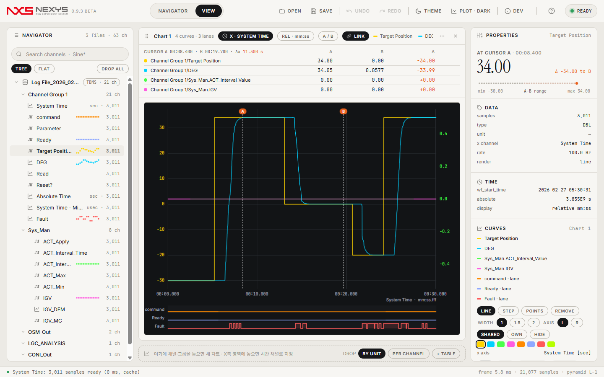](docs/images/view.png)

* * *

## 설치와 실행

### 설치형 (권장)
1. [Releases](https://github.com/Kim-Hakseong/nexys-view/releases)에서 `NexysView-1.1.0-beta.2-setup.exe`를 받아 실행한다.
2. Program Files에 설치되고 시작 메뉴·바탕화면 바로가기가 만들어진다. `.tdms` / `.tdm` / `.dxd` / `.mf4` / `.mdf` 연결은 설치 중 선택(기본 해제).
3. Microsoft Edge WebView2 런타임이 없는 PC에서는 설치 중에 자동으로 받아 설치한다(인터넷 필요). Windows 11과 최신 Windows 10에는 이미 들어 있다.

### 포터블
`NexysView.exe` 1개(약 82 MB)를 아무 폴더에 두고 더블클릭한다. 첫 실행 때 `%TEMP%\.net\NexysView\`에 풀린다. WebView2 런타임은 설치형과 같은 조건.

> ⚠️ 포터블에는 Python DataPlugin 워커(`NexysView.PluginHost.exe`)가 들어 있지 않다. DataPlugin이 필요하면 설치형을 쓴다.

### 첫 실행
[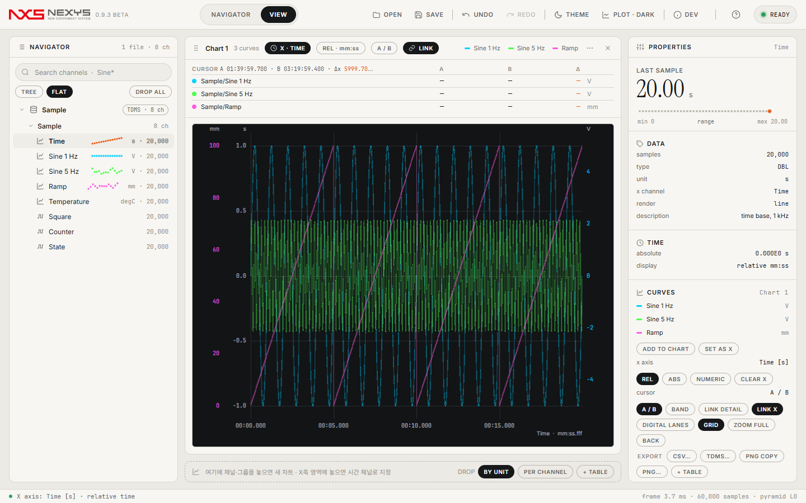](docs/images/sample.png)
처음 실행하면 내장 샘플 `Sample.tdms`(합성 신호 8채널, 20 s @ 1 kHz)가 열려 있다. 자기 파일은 창 어디에나 끌어다 놓거나 **OPEN**으로 연다. 샘플 `Sample.tdms`는 `%LOCALAPPDATA%\NexysView\sample\`에 한 번 만들어진다. 이전 세션의 파일과 차트는 다시 열지 않는다(창 크기·테마·모드만 복원).

### 소스에서 실행
```
git submodule update --init                       # app/core = nexys-core
cd app/web && npm install && npm run build        # 페이지 → app/web/dist (공통 코드 @core = app/core/NexysView.Web)
dotnet build app/NexysView.App/NexysView.App.csproj -c Release
app\NexysView.App\bin\Release\net8.0-windows\win-x64\NexysView.exe
```
.NET 8 SDK, Node 20+ 필요.

* * *

## 화면

### NAVIGATOR — 파일·채널 트리와 데이터 소스
[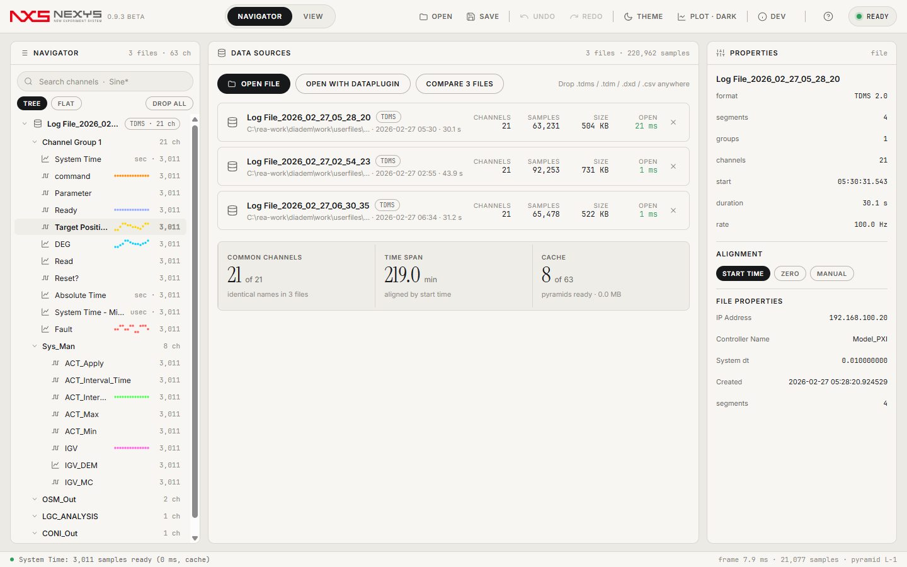](docs/images/navigator.png)
- 파일 ▸ 그룹 ▸ 채널 트리. 이름에 `.`이 있는 채널(`Sys_Man.ACT_Apply`)은 계층으로 접힌다(TREE/FLAT).
- 검색은 부분 문자열 또는 `*` `?` 와일드카드(`Sine*`, `Sys_Man.*`). **DROP ALL (n)** 이 일치 채널로 차트를 만든다.
- 데이터 소스 카드: 채널·샘플 수·크기·열기 시간, 공통 채널 수, 시간 범위, 피라미드 캐시.
- 파일을 Ctrl-클릭으로 여러 개 고르고 **COMPARE n FILES** → 공통 채널을 파일별 곡선으로 겹쳐 본다(정렬: 시작 시각 / 0 s / 수동 오프셋).

### VIEW — 차트
[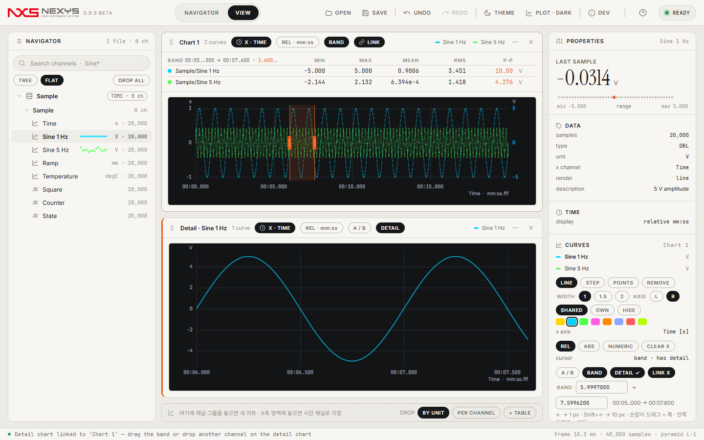](docs/images/detail.png)
- **드롭**: 채널을 빈 영역에 놓으면 새 차트, 차트 위에 놓으면 곡선 추가, 왼쪽/오른쪽 축 영역에 놓으면 축 지정, **아래 x축 영역에 시간 채널을 놓으면 X축**. **파일·그룹·이름 노드를 통째로 놓으면 바로 차트**가 된다 — 드롭 존의 **BY UNIT**(단위별 Y축으로 차트 1개, 정수·불리언은 디지털 레인) / **PER CHANNEL**(채널마다 차트). 파일의 시간 채널은 자동으로 X축이 되고, 50개가 넘는 큰 드롭은 확인 없이 만들고 상태줄에 개수를 표시한다(최대 256).
- **줌**: 휠(커서 기준), **오른쪽 드래그 = 영역 확대**(점선 사각 미리보기, `Shift` = X만, `Ctrl` = Y만), 왼쪽 드래그 = 이동, 더블클릭 = 전체, **`Backspace` = 줌 되돌리기**(20단계).
- **커서**: 자유 커서 A/B(클릭 / `Shift`+클릭, 값·Δ·구간 min/max/mean) 또는 **밴드 커서**(`Ctrl+B`, 헤더의 A / B 알약). 밴드는 시작·끝 손잡이 + 반투명 영역: 손잡이 드래그 = 폭, 안쪽 드래그 = 이동, `←` `→` = 1 px, `Shift`+`←` `→` = 10 px, PROPERTIES의 BAND 입력 = 정확한 값. 판독 띠에 밴드 구간의 곡선별 **min / max / mean / RMS / p-p**와 구간 길이.
- **개요/상세 연동**: 차트 메뉴(⋯) → **상세 차트 연결**. 개요 차트의 밴드 구간만 보여주는 상세 차트가 아래에 생긴다. 밴드를 움직이면 상세 X범위가 즉시 바뀌고, 상세에서 줌·팬하면 밴드가 따라온다. 상세에 보일 채널은 개요 범례 클릭 / PROPERTIES의 SHOW IN DETAIL / 상세 차트에 채널 드롭으로 바꾼다.
- **X축 링크**: 같은 X채널(또는 같은 파일·단위)을 쓰는 차트는 기본으로 팬·줌이 함께 움직인다. 헤더 **LINK** 알약으로 차트별 해제. 링크된 차트에는 개요의 밴드가 연한 점선으로 보인다.
- X축이 시간 채널이면 눈금이 `mm:ss.fff`(상대) 또는 `HH:mm:ss`(절대, 1904 epoch)로 바뀌고 커서 값은 원본 샘플을 읽는다. 정수·불리언·값이 8개 이하인 채널은 자동으로 계단으로 그려지고, **DIGITAL LANES**를 켜면 플롯 아래 0/1 레인으로 쌓인다.
- 범례 클릭 = 숨김(상세가 연결된 개요에서는 상세 채널 선택, `Shift`+클릭 = 숨김), 범례 드래그 = 다른 차트로 이동, 헤더 그립 드래그 = 차트 순서 교환.

### 페이지와 여러 창
[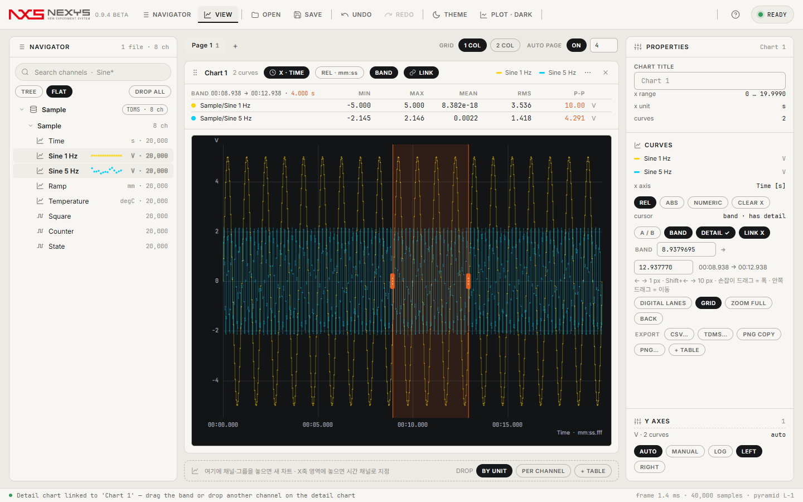](docs/images/main_window.png)
- **페이지**: VIEW 위의 탭(Page 1, +)으로 차트를 나눠 둔다. 클릭 = 보기, 더블클릭 = 이름 바꾸기, 드래그 = 순서, × = 제거(차트는 다른 페이지로 옮겨지며 삭제되지 않음, 차트가 있으면 확인). `Ctrl+PageDown` / `Ctrl+PageUp`으로 이동.
- **GRID 1 COL / 2 COL**: 페이지의 차트 격자. 차트 헤더 그립 드래그로 순서를 바꾼다. **AUTO PAGE ON n**: 차트가 n개(기본 4)를 넘으면 새 페이지가 자동으로 생긴다.
- **새 창으로**: 차트 메뉴(⋯) → 새 창으로, 또는 헤더 그립을 창 밖으로 드래그. 차트가 별도 창(WebView2)으로 옮겨지고 같은 세션을 공유하므로 X축 링크·밴드·개요/상세·커서가 창을 넘어 함께 움직인다. 창을 닫거나 **RETURN ALL**을 누르면 차트는 주 창으로 돌아온다(삭제 아님). 창 위치·크기는 레이아웃에 저장되고, 그 모니터가 없으면 주 모니터에 연다.

[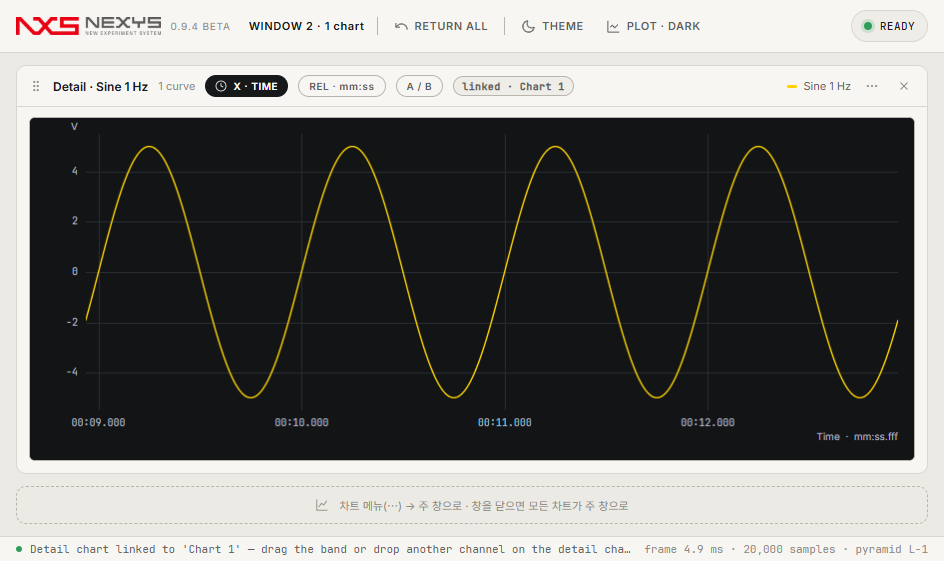](docs/images/window.png)
[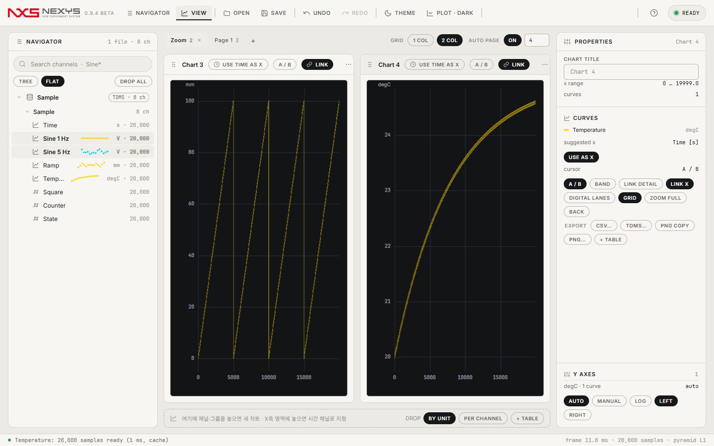](docs/images/pages.png)

### PROPERTIES — 축·곡선 설정
- **Y축**: AUTO / MANUAL(min·max 입력), LOG, LEFT / RIGHT. 단위별로 축을 공유하고 곡선마다 SHARED / OWN으로 분리할 수 있다.
- **곡선**: LINE / STEP / POINTS, 굵기 1·1.5·2, 색 8가지, 숨김. GRID on/off. 모든 설정은 레이아웃에 저장된다.

### 값 테이블
[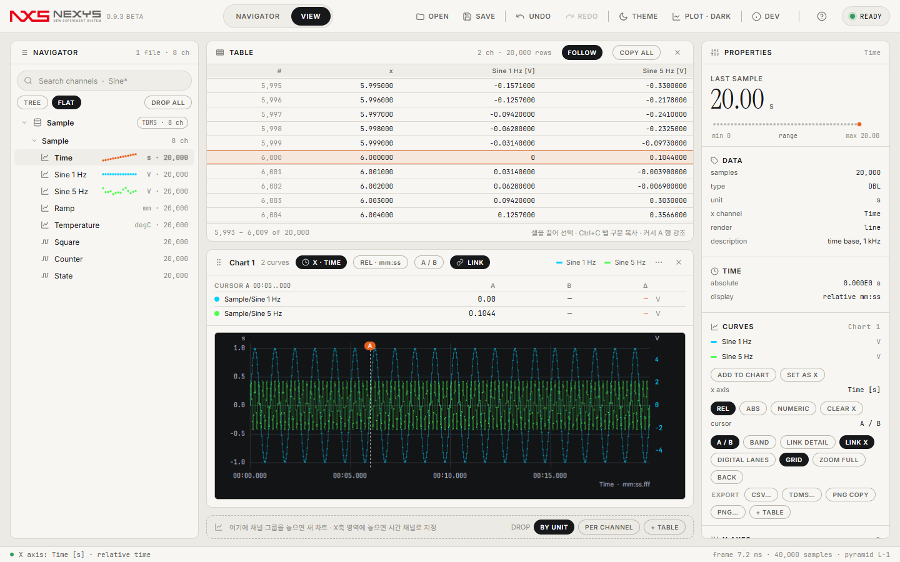](docs/images/table.png)
- 드롭 존의 **+ TABLE**(활성 차트의 채널) 또는 `Alt`+드롭. 열은 # · x · 채널들. 1,000만 샘플도 가상 스크롤로 즉시 보인다.
- 활성 차트의 커서 A 행이 강조되고 **FOLLOW**가 켜져 있으면 따라 스크롤한다. 셀을 끌어 영역을 고르고 **`Ctrl+C`로 탭 구분 복사**(최대 100,000행), **COPY ALL**은 보이는 열 전체.

### 버스 캡처 → NexysBus
[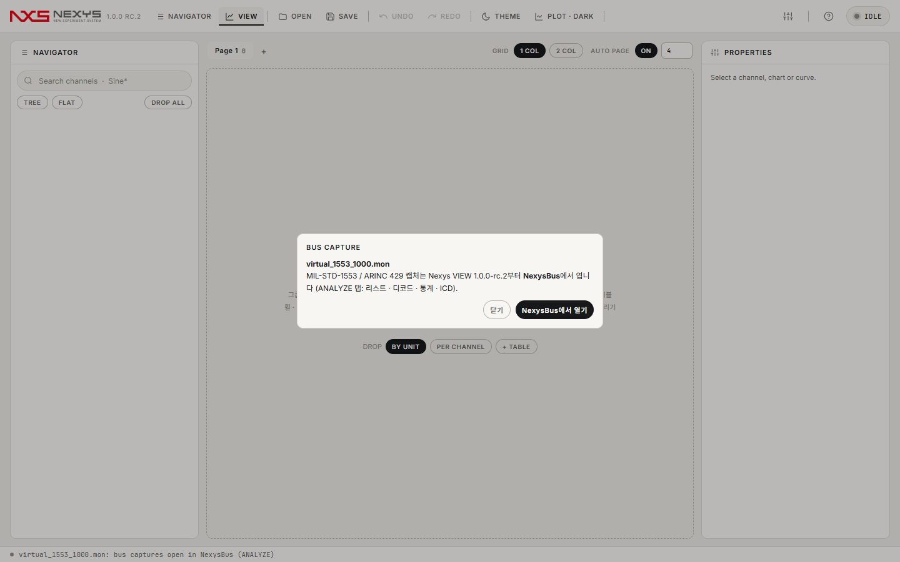](docs/images/bus_notice.png)
- `.mon`(MIL-STD-1553 / ARINC 429)을 열거나 끌어다 놓으면 **NexysBus에서 열기** 안내가 뜬다. NexysBus가 설치돼 있으면(exe 옆·`%LOCALAPPDATA%\Programs\NexysBus`·Program Files) 그 파일로 바로 실행되고, 없으면 릴리스 페이지가 열린다.
- 리스트·필터·디코드·추이·통계·CSV와 ICD 모듈은 NexysBus의 ANALYZE / ICD 레일에 그대로 있다(같은 엔진, nexys-core).

### 내보내기
- 차트 메뉴(⋯) 또는 PROPERTIES → EXPORT: 밴드 구간(없으면 전체)의 차트 채널을 **CSV / TDMS**로 저장. 차트 **PNG 복사·저장**. 모든 채널 TDMS 저장은 `Ctrl+S`.

### 설정 · 도움말 · 정보
[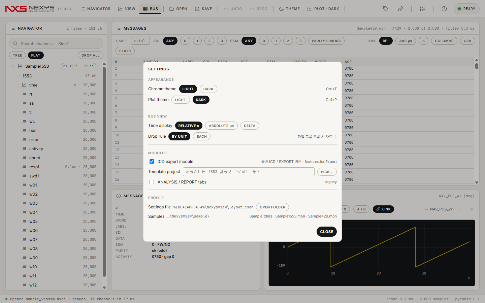](docs/images/settings.png)
- **설정**(툴바 슬라이더 아이콘): 크롬 테마 · 플롯 테마 · 드롭 규칙 · legacy ANALYSIS/REPORT 탭 · 설정 파일 폴더 열기. 설정 파일은 `%LOCALAPPDATA%\NexysView\layout.json`.
- 처음 실행하면 **기능 투어**가 자동으로 시작된다. `F1` 또는 **?** 버튼의 **사용 가이드**는 시작하기 · 화면 구성 · 차트 조작 · 밴드·상세 보기 · 테이블·내보내기 · 단축키 · 활용 팁 절.
- **정보**(로고 클릭): 버전과 피드백 링크만.

[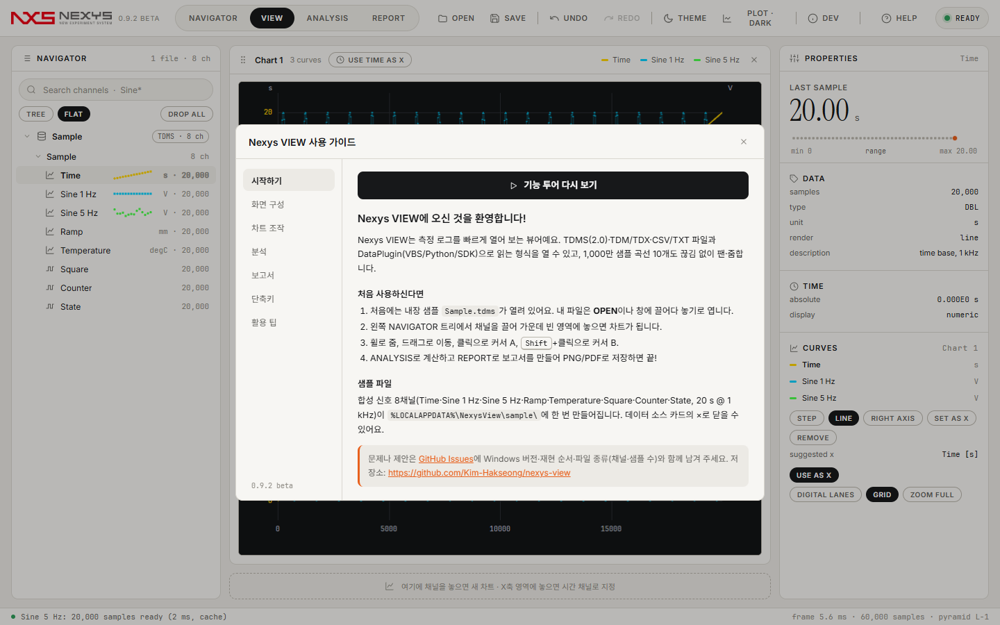](docs/images/help.png)

* * *

## 주요 기능
- **큰 파일**: 1 GB TDMS를 수십 ms에 열고(메모리 맵), 채널마다 min/max 피라미드를 만들어 1,000만 샘플 곡선 10개를 한 화면에서 끊김 없이 팬·줌한다. 피라미드는 파일 옆 `.nvcache`에 저장돼 다음에 바로 쓴다.
- **탐색 도구에 집중**: 툴바 첫 그룹은 NAVIGATOR · VIEW. 그룹 드롭 → 차트, 오른쪽 드래그 줌, 밴드 커서, 개요/상세 연동, X축 링크, 값 테이블, CSV/TDMS/PNG 내보내기, **페이지**와 **여러 창**. (ANALYSIS·REPORT 탭은 설정의 legacy 스위치로만 표시)
- **시간축 로그**: `System Time`/`Absolute Time` 같은 시간 채널 자동 인식 → 시간축 제안(USE … AS X), 상대/절대 시각 눈금, 계단 신호 + 디지털 레인, 이름 계층 트리(`A.B.C`), 로그 여러 개를 시작 시각으로 정렬해 비교.
- **버스 캡처**: NexysBus로 이사(1.0.0-rc.2). `.mon`을 열면 안내 → NexysBus 실행.
- **형식**: TDMS(2.0, 세그먼트 10만 개 파일 포함) · TDM/TDX · CSV/TXT(자동 감지) · DXD · MDF 3.x/4.x(MF4; 값→텍스트 채널은 계단 곡선 + 커서 표·PROPERTIES에 텍스트) · VBS/Python/SDK DataPlugin(`Ctrl+Shift+O`) · TDMS 저장(`Ctrl+S`) · 레이아웃 파일(.tdv) 가져오기.
- **라이트/다크 테마**, 밝은 플롯(점 격자) 옵션, 창 크기·테마·모드·축/곡선 설정·필터 프리셋 복원(파일·차트는 다시 열지 않음), Undo/Redo.

## 수치 (1.0.1, 같은 PC, 셀프테스트 측정 — 버스·ICD 수치는 NexysBus README)
| 항목 | 값 | 관문 |
|---|---|---|
| 프로세스 시작 → 페이지 준비 | 1.9–2.6 s (3회) | ≤ 3 s |
| 1 GB TDMS 열기 (16 ch × 8M) | 33 ms | ≤ 100 ms |
| 10,000 채널 TDMS 열기 | 265 ms | ≤ 2 s |
| 10곡선 × 10M 표시 후 Working Set | 524 MB (private 354 MB) | ≤ 600 MB |
| 100만 건 필터 RT / 오류만 | 8.9 ms / 32.7 ms | ≤ 100 ms |
| 100만 건 리스트 스크롤 paint 평균 / 최대 | 3.9 ms / 5.3 ms | ≤ 8 / ≤ 30 ms |
| DXD·설정·도움말 셀프테스트 후 Working Set | 198 MB | ≤ 600 MB |
| 스트레스 50회(TDMS·DXD·MON 혼합, 창 12개) UI 정지 300 ms · 메모리 증가 | 0 · +23 MB | 0 · ≤ 100 MB |
| 강조색 테두리·띠 (accent 스캔) | 0 | 0 |
| 1 GB MDF 열기 — 비압축 / deflate (50 ch × 2.6M, 1.1.0-beta.1) | 39 ms / 315 ms | ≤ 500 / ≤ 1,000 ms |
| 1 GB MDF 첫 화면(10곡선 피라미드, 캐시 없음) — 비압축 / deflate | 1.74 s / 1.39 s | ≤ 2 s |
| 1 GB MDF 10곡선 팬·줌 프레임 중앙값 | 5.8 / 8.3 ms | ≤ 16 ms |
| 2,000채널 MDF 열기 + NAVIGATOR | 113 ms | ≤ 300 ms |
| MDF 정답지 비트 대조(21파일, asammdf 기준) | 281/281 | 전부 |
| 1 GB CSV 첫 열기(파싱) / 재열기(캐시) — 51열 × 2.0M행 | 2.4–4.1 s / 0.08–0.24 s | ≤ 5 s / ≤ 0.3 s |
| 1 GB CSV 첫 화면 10곡선 · 팬·줌 프레임 중앙값 | ≤ 0.21 s · ≤ 6.9 / 7.6 ms | ≤ 2 s · ≤ 16 ms |
| CSV 정답지 대조(21파일: 형식 감지·값 비트 동일·캐시) | 426/426 | 전부 |

측정 방법·원본 수치: [docs/mf4/report-mf4.md](docs/mf4/report-mf4.md), [docs/rc2-report.md](docs/rc2-report.md), [docs/100rc-report.md](docs/100rc-report.md), [docs/094-report.md](docs/094-report.md), [docs/093-report.md](docs/093-report.md), [docs/webview-report.md](docs/webview-report.md), [docs/v3-report.md](docs/v3-report.md).

## 지원 형식
| 형식 | 읽기 | 쓰기 | 비고 |
|---|---|---|---|
| .tdms | ✅ | ✅ | 2.0, DAQmx raw는 보고만, 미완성 마지막 세그먼트 무시 |
| .tdm / .tdx | ✅ | — | raw_linear · implicit_linear · string_sequence |
| .csv / .txt / .tsv / .xyz | ✅ | — | 인코딩·구분자·소수점·헤더/단위 줄·전문·시간 열(타임스탬프 포함) 자동 감지, 확신 낮으면 가져오기 대화상자, 병렬 파싱 + 캐시. 미지원: 열마다 시간 열이 따로 있는 x,y 쌍 배치, 고정 폭 텍스트, 천 단위 구분 기호, 날짜·시간 두 열 분리, 따옴표 안 줄바꿈 |
| .dxd | ✅ | — | 멀티레이트·IEEE 32/64, 저장소 빌드 포함 |
| .mf4 / .mdf / .dat (ASAM MDF) | ✅ 베타 | — | 4.00–4.11 전체 블록(4.2는 4.1 집합으로, LD 열 저장 제외) · 3.0–3.3 · 정렬/비정렬 · DZ deflate/transposed · 비트 패킹·BE · 변환 LIN/RAT/ALG/TABI/TAB/RTAB/TABX/RTABX · 무효 비트→NaN · VLSD 텍스트 · 구조체·CA(CN 템플릿) · 바이트 배열 ≤64 B 원소 · CAN 로깅 원시 채널 · AT/EV 목록. 미지원: CA storage 1/2·축, 비정렬 VLSD, TTAB/TRANS/BITFIELD, 3.x BE 헤더 |
| DataPlugin (.vbs / .py / .dll) | ✅ | — | VBS 객체 모델 부분집합, Python 마셜러 워커, C++ SDK DLL |
| .mon (MIL-STD-1553 / ARINC 429 캡처) | → NexysBus | — | 열면 "NexysBus에서 열기" 안내 |
| .tdv | ✅ | — | VIEW 레이아웃 → 차트·테이블 |

## 단축키·조작
| 동작 | 입력 |
|---|---|
| 열기 / DataPlugin으로 열기 / TDMS 저장 | `Ctrl+O` / `Ctrl+Shift+O` / `Ctrl+S` |
| 모드 전환 | `Ctrl+1` NAVIGATOR · `Ctrl+2` VIEW |
| 테마 / 플롯 밝기 / 개발자 정보(상태줄 표시) | `Ctrl+T` / `Ctrl+P` / `Ctrl+Shift+D` |
| 페이지 이동 / 새 페이지 | `Ctrl+PageDown` · `Ctrl+PageUp` / 탭 줄의 `+` |
| 차트를 새 창으로 / 주 창으로 | 차트 메뉴 ⋯ → 새 창으로 · 그립을 창 밖으로 드래그 / 창 닫기 · RETURN ALL |
| Undo / Redo | `Ctrl+Z` / `Ctrl+Y` |
| 사용 가이드 · 기능 투어 / 정보 대화상자 / 설정 | `F1` 또는 `?` 버튼 / 로고 클릭 / 슬라이더 아이콘 |
| 투어 안에서 | `→` 다음 · `←` 이전 · `Esc` 닫기 |
| 줌 / 팬 / 전체 보기 / 줌 되돌리기 | 휠 / 왼쪽 드래그 / 더블클릭 / `Backspace` |
| 영역 확대 | 오른쪽 드래그 · `Shift`+오른쪽 드래그 = X만 · `Ctrl`+오른쪽 드래그 = Y만 |
| 커서 A / 커서 B / 커서 해제 | 클릭 / `Shift`+클릭 / 우클릭 |
| 밴드 커서 ↔ 자유 커서 / 밴드 이동 | `Ctrl+B` / `←` `→` (1 px) · `Shift`+`←` `→` (10 px) |
| 새 차트 / 곡선 추가 / 축 지정 / X축 지정 / 값 테이블 | 빈 영역 드롭 / 차트 드롭 / 좌·우 축 영역 드롭 / 아래 x축 영역 드롭 / `Alt`+드롭 |
| 파일·그룹 전체를 차트로 | 트리의 파일·그룹·노드 행을 VIEW에 드롭 |
| XY 차트 | 트리에서 `Ctrl`-클릭으로 채널 2개 고른 뒤 드롭 |
| 상세 차트 연결 / 차트 메뉴 | 차트 헤더 ⋯ |
| 테이블 선택 복사 | 셀 드래그 → `Ctrl+C` |
| 파일 비교 | 파일 행 `Ctrl`-클릭 → COMPARE |

## 알려진 문제 (1.1.0-beta.2)
- CSV: 첫 열기는 파싱 결과를 메모리에 둔다(1 GB 텍스트 → 약 0.8–1.2 GB). 두 번째부터는 `.nvcache`의 캐시를 매핑해 바로 연다. 열마다 시간 열이 따로 있는 x,y 쌍 배치·고정 폭 텍스트·천 단위 구분 기호·날짜/시각 두 열 분리는 시간 축 없이 열린다.
- MDF: 생성 도구(asammdf)와 자체 라이터로 만든 파일로만 검증했다 — 실제 로거(벤더) 파일은 다음 베타에서. 압축 파일은 레코드를 메모리에 풀어 두므로(RAM/4, 최대 3 GB 예산) 1 GB 파일을 열면 프로세스 메모리 ~2.5 GB. 채널 하나를 읽어도 그룹 레코드 전체를 훑는 형식 구조라 첫 화면은 파일 크기에 비례한다. DBC 디코드·MDF 저장은 아직 없다.
- 버스 캡처(.mon)는 이 앱이 열지 않는다 — 안내 창에서 NexysBus로 넘긴다(설치돼 있지 않으면 경로 안내만).
- 시뮬레이터 프로젝트 내보내기는 템플릿 프로젝트 폴더(CDV + CPJ)가 있어야 하고, 필드의 비트 범위·타입·분해능만 쓴다(offset·단위·주기는 허브·XML에만). 자동화 스크립트는 시뮬레이터 COM이 감지될 때만 켜진다.
- 커스텀 디바이스 XML은 공개 문서 기반 스키마로 만든다. 실제 시스템 로드는 아직 확인하지 않았다.
- 메모리: 10곡선 × 10M을 띄우고 상세 연동·밴드 드래그를 하면 앱 프로세스 ~520 MB(메모리 맵 파일 페이지 포함, 힙 ~350 MB) + WebView2 프로세스 ~580 MB. 떼어낸 창 하나당 앱 +13~16 MB, WebView2 프로세스 +약 100 MB. 창을 닫으면 돌아온다.
- 밴드 판독 띠의 mean·RMS는 구간이 65,536 샘플을 넘으면 최대 2,048개 표본으로 추정한 값(≈ 표시). min/max와 CSV/TDMS 내보내기는 정확하다.
- 떼어낸 창에는 NAVIGATOR가 없다(주 창에서 곡선을 바꾼 뒤 창으로 보낸다). 창 간 차트 드래그는 지원하지 않는다.
- 첫 프레임은 공유 메모리 버퍼가 도착하기 전이라 조금 느리다(약 100 ms).
- X축 매핑은 샘플 수가 같은 곡선만 된다. 절대 시각은 UTC로만 표시한다. 계단 자동 감지는 앞 10만 샘플만 본다.
- 로그 축은 0 이하 값을 건너뛴다. 값 테이블의 x 열은 활성 차트의 X 매핑을 따른다(차트에 없는 채널은 자기 x).
- 포터블에는 Python DataPlugin 워커가 없다.

## 피드백
[GitHub Issues](https://github.com/Kim-Hakseong/nexys-view/issues)에 다음을 적어 주세요: Windows 버전, 재현 순서, 가능하면 파일 종류(채널 수·샘플 수)와 `%LOCALAPPDATA%\NexysView\` 아래 로그. 앱 안에서는 `F1` → 정보 → GitHub Issues.

## 개발
```
app/
  core/               nexys-core submodule: NexysView.Core(형식·버스·ICD) · NexysView.Render(플롯) · NexysView.Host(EngineBase·Bridge·FrameServer·Mil1553Service·HostCommands) · NexysView.Web(@core 페이지 공통)
  NexysView.Render/   차트 모델, 눈금, 시간축, 보고서(Skia)
  NexysView.App/      WPF 창 + WebView2 호스트, Engine(EngineBase + 분석·보고서·.tdv·내보내기), 가져오기/내보내기, 플러그인, 셀프테스트
  NexysView.PluginHost/  C++ DataPlugin 워커(SDK DLL·Python 마셜러)
  NexysView.Tests/    xUnit (DXD·MDF 정답지 비트 일치 포함 — data/mdf 샘플 21개 + 생성 스크립트; 관문 테스트는 로컬 기준 데이터가 필요해 저장소에서는 제외)
  web/                페이지 (Vite + TypeScript, 프레임워크 없음): main · nav · view · settings · help ; bridge·plot·icons·util·types는 @core
design/               목업(정답 화면: view · navigator · bus · icd · settings …)·디자인 문서·브랜드
installer/            Inno Setup 스크립트, 라이선스 텍스트
tools/pixel_diff.py   목업 대 앱 캡처 구조 비교
```
자동화: `NexysView.exe --selftest --out <dir>`(관문·캡처), `--v3`(시간축 로그), `--v093`(그룹 드롭·줌·밴드·상세·테이블), `--v094`(툴바·강조 제거·드래그 미리보기·창·페이지), `--v0100 [--truth <mon>] [--template <dir>]`(1553 100만 레코드·ICD·프로젝트 내보내기), `--v100rc [--xlsx <file>] [--template <dir>]`(BUS 빈 화면·샘플·정렬·키보드·시간 단위·필터·프리셋·통계·CSV·ICD 가져오기/편집/검증/4형식 내보내기·429·DXD·설정·도움말·정보), `--stress --iter 200`(TDMS·DXD 혼합), `--shot --open <file> --mode VIEW [--detail 1 | --table 1 | --tour n | --help section]`.

## 라이선스
베타 평가용 라이선스 — [LICENSE.txt](LICENSE.txt). 번들 글꼴은 SIL Open Font License 1.1: Inter, Noto Sans KR, Instrument Serif, JetBrains Mono, Pretendard([installer/licenses](installer/licenses)). 아이콘 Lucide(ISC), SkiaSharp(MIT), Microsoft.Web.WebView2(Microsoft 라이선스), WebView2 런타임은 Microsoft 배포 조건을 따른다.
