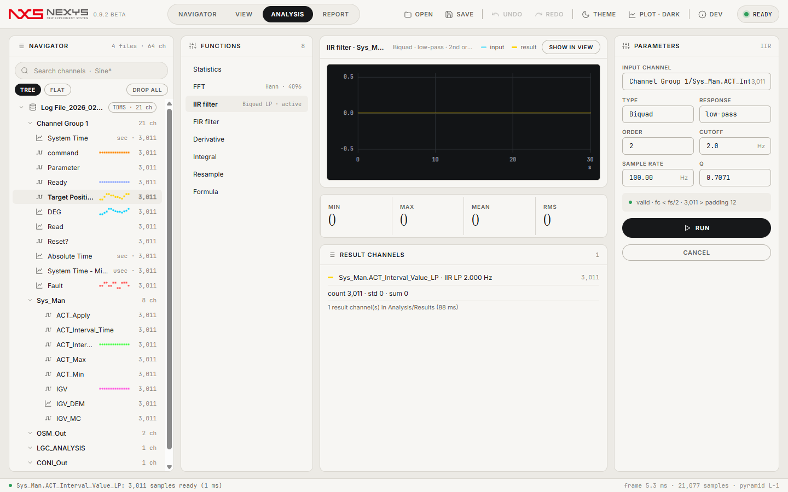

<p align="center"></p>

# Nexys VIEW

**측정 데이터 뷰어 — TDMS·TDM 로그를 열고, 1,000만 샘플 곡선을 16 ms 안에 움직이고, VeriStand 로그를 시간축 그대로 본다.**

   

C# 12 / .NET 8 · WPF 창 + WebView2 페이지(TypeScript) · SkiaSharp 보고서 · 단위 테스트 514개

> ⚠️ 베타입니다. 기능·화면·파일 형식이 바뀔 수 있습니다. 문제는 [GitHub Issues](https://github.com/Kim-Hakseong/nexys-view/issues)로 알려 주세요 (앱 안 `F1` → 정보 대화상자의 링크).

[](docs/images/view.png)

* * *

## 설치와 실행

### 설치형 (권장)
1. [Releases](https://github.com/Kim-Hakseong/nexys-view/releases)에서 `NexysView-0.9.1-beta-setup.exe`를 받아 실행한다.
2. Program Files에 설치되고 시작 메뉴·바탕화면 바로가기가 만들어진다. `.tdms` / `.tdm` / `.dxd` 연결은 설치 중 선택(기본 해제).
3. Microsoft Edge WebView2 런타임이 없는 PC에서는 설치 중에 자동으로 받아 설치한다(인터넷 필요). Windows 11과 최신 Windows 10에는 이미 들어 있다.

### 포터블
`NexysView.exe` 1개(약 82 MB)를 아무 폴더에 두고 더블클릭한다. 첫 실행 때 `%TEMP%\.net\NexysView\`에 풀린다. WebView2 런타임은 설치형과 같은 조건.

> ⚠️ 포터블에는 Python DataPlugin 워커(`NexysView.PluginHost.exe`)가 들어 있지 않다. DataPlugin이 필요하면 설치형을 쓴다.

### 소스에서 실행
```
cd app/web && npm install && npm run build        # 페이지 → app/web/dist
dotnet build app/NexysView.App/NexysView.App.csproj -c Release
app\NexysView.App\bin\Release\net8.0-windows\win-x64\NexysView.exe
```
.NET 8 SDK, Node 20+ 필요. `.dxd` 리더는 별도 프로젝트에 의존하므로 저장소 빌드에서는 빠진다(배포본에는 포함).

* * *

## 화면

### NAVIGATOR — 파일·채널 트리와 데이터 소스
[](docs/images/navigator.png)
- 파일 ▸ 그룹 ▸ 채널 트리. 이름에 `.`이 있는 채널(`Sys_Man.ACT_Apply`)은 계층으로 접힌다(TREE/FLAT).
- 검색은 부분 문자열 또는 `*` `?` 와일드카드(`Sys_Man.*`). **DROP ALL (n)** 이 일치 채널로 차트를 만든다.
- 데이터 소스 카드: 채널·샘플 수·크기·열기 시간, 공통 채널 수, 시간 범위, 피라미드 캐시.
- 파일을 Ctrl-클릭으로 여러 개 고르고 **COMPARE n FILES** → 공통 채널을 파일별 곡선으로 겹쳐 본다(정렬: 시작 시각 / 0 s / 수동 오프셋).

### VIEW — 차트
- 채널을 빈 영역에 놓으면 새 차트, 차트 위에 놓으면 곡선 추가, 왼쪽/오른쪽 축 영역에 놓으면 축 지정, **아래 x축 영역에 시간 채널을 놓으면 X축**이 된다.
- X축이 시간 채널이면 눈금이 `mm:ss.fff`(상대) 또는 `HH:mm:ss`(절대, 1904 epoch)로 바뀌고 커서 값은 원본 샘플을 읽는다.
- 정수·불리언·값이 8개 이하인 채널은 자동으로 계단(sample-and-hold)으로 그려지고, **DIGITAL LANES**를 켜면 플롯 아래 0/1 레인으로 쌓인다.
- 커서 A/B 표: A·B 값, Δ, 구간 min/max/mean. 범례 클릭 = 숨김, 범례 드래그 = 다른 차트로 이동, 헤더 그립 드래그 = 차트 순서 교환.

### ANALYSIS — 통계·FFT·필터·수식
[](docs/images/analysis.png)
- Statistics · FFT(Hann/Hamming/Blackman/Rect) · IIR filter(biquad LP/HP) · FIR filter · Derivative · Integral · Resample · Formula.
- 결과는 `Analysis/Results` 채널로 들어가고 **SHOW IN VIEW**로 바로 차트가 된다. 수식은 `Ch("Results/y") = 2 * Ch("$1") + 1` 꼴.

### REPORT
제목·텍스트·차트 스냅샷·값 테이블 블록을 A4 페이지로 미리 보고 PNG(2×)·PDF로 내보낸다.

* * *

## 주요 기능
- **큰 파일**: 1 GB TDMS를 수 ms에 열고(메모리 맵), 채널마다 min/max 피라미드를 만들어 1,000만 샘플 곡선 10개를 한 화면에서 끊김 없이 팬·줌한다. 피라미드는 파일 옆 `.nvcache`에 저장돼 다음에 바로 쓴다.
- **VeriStand 로그 특화**: `System Time`/`Absolute Time` 자동 인식 → 시간축 제안(USE SYSTEM TIME AS X), 상대/절대 시각 눈금, 계단 신호 + 디지털 레인, `Sys_Man.*` 계층 트리, 로그 여러 개를 시작 시각으로 정렬해 비교.
- **형식**: TDMS(2.0, 세그먼트 10만 개 파일 포함) · TDM/TDX · CSV/TXT(자동 감지) · DXD(배포본) · VBS/Python/SDK DataPlugin(`Ctrl+Shift+O`) · TDMS 저장(`Ctrl+S`) · 레이아웃 파일(.tdv) 가져오기.
- **라이트/다크 테마**, 밝은 플롯(점 격자) 옵션, 창·파일·차트 레이아웃 자동 복원, Undo/Redo.

## 성능 (같은 PC, 기준 상용 분석 도구와 비교)
| 항목 | Nexys VIEW 0.9.1 beta | 기준 상용 도구 |
|---|---|---|
| 1 GB TDMS 열기 (16 ch × 8M) | 6 ms | 29 ms |
| 10M 샘플 첫 곡선 표시 (드롭 → 피라미드 → 첫 프레임) | 0.35 s | 1.06 s |
| 10곡선 × 10M 표시 | 1.9 s | 15.5 s |
| 10,000 채널 파일 열기 + 트리 | 0.34 s + 0.08 s | 9.5 s |
| 10곡선 × 10M 팬·줌 프레임 (브리지 왕복 포함, median) | 5 ms | — |
| TDMS 재판독 일치 / TDM 리더 일치 | 100 % | — |
| 분석 함수 정답지 대비 최대 상대 오차 | 2.9e-16 | — |

측정 방법·원본 수치: [docs/webview-report.md](docs/webview-report.md), [docs/v3-report.md](docs/v3-report.md), [docs/final-report.md](docs/final-report.md).

## 지원 형식
| 형식 | 읽기 | 쓰기 | 비고 |
|---|---|---|---|
| .tdms | ✅ | ✅ | 2.0, DAQmx raw는 보고만, 미완성 마지막 세그먼트 무시 |
| .tdm / .tdx | ✅ | — | raw_linear · implicit_linear · string_sequence |
| .csv / .txt / .xyz | ✅ | — | 구분자·헤더 자동 감지 |
| .dxd | ✅ (배포본) | — | 저장소 빌드에는 없음 |
| DataPlugin (.vbs / .py / .dll) | ✅ | — | VBS 객체 모델 부분집합, Python 마셜러 워커, C++ SDK DLL |
| .tdv | ✅ | — | VIEW 레이아웃 → 차트·테이블 |

## 단축키·조작
| 동작 | 입력 |
|---|---|
| 열기 / DataPlugin으로 열기 / TDMS 저장 | `Ctrl+O` / `Ctrl+Shift+O` / `Ctrl+S` |
| 모드 전환 | `Ctrl+1` NAVIGATOR · `Ctrl+2` VIEW · `Ctrl+3` ANALYSIS · `Ctrl+4` REPORT |
| 테마 / 플롯 밝기 / 개발자 정보 | `Ctrl+T` / `Ctrl+P` / `Ctrl+D` |
| Undo / Redo | `Ctrl+Z` / `Ctrl+Y` |
| 정보 대화상자 | `F1` 또는 로고 클릭 |
| 줌 / 팬 / 영역 줌 / 전체 보기 | 휠 / 드래그 / `Shift`+드래그 / 더블클릭 |
| 커서 A / 커서 B / 커서 해제 | 클릭 / `Shift`+클릭 / 우클릭 |
| 새 차트 / 곡선 추가 / 축 지정 / X축 지정 / 값 테이블 | 빈 영역 드롭 / 차트 드롭 / 좌·우 축 영역 드롭 / 아래 x축 영역 드롭 / `Alt`+드롭 |
| XY 차트 | 트리에서 `Ctrl`-클릭으로 채널 2개 고른 뒤 드롭 |
| 파일 비교 | 파일 행 `Ctrl`-클릭 → COMPARE |

## 알려진 문제 (0.9.1 beta)
- 메모리: 10곡선 × 10M을 띄운 뒤 앱 프로세스 ~600 MB + WebView2 프로세스 ~500 MB. 차트를 많이 만들고 닫으면 브라우저 프로세스 메모리가 바로 줄지 않는다(창을 닫으면 해제).
- 첫 프레임은 공유 메모리 버퍼가 도착하기 전이라 조금 느리다(약 100 ms).
- X축 매핑은 샘플 수가 같은 곡선만 된다. 절대 시각은 UTC로만 표시한다.
- 계단 자동 감지는 앞 10만 샘플만 본다.
- 값 테이블은 100행씩 넘겨 본다.
- 포터블에는 Python DataPlugin 워커가 없다.

## 피드백
[GitHub Issues](https://github.com/Kim-Hakseong/nexys-view/issues)에 다음을 적어 주세요: Windows 버전, 재현 순서, 가능하면 파일 종류(채널 수·샘플 수)와 `%LOCALAPPDATA%\NexysView\` 아래 로그. 앱 안에서는 `F1` → 정보 → GitHub Issues.

## 개발
```
app/
  NexysView.Core/     TDMS·TDM 리더/라이터, 피라미드, DSP, 수식 엔진
  NexysView.Render/   차트 모델, 눈금, 시간축, 보고서(Skia)
  NexysView.App/      WPF 창 + WebView2 호스트, Engine·Bridge·FrameServer, 분석·보고서 서비스, 가져오기/내보내기, 셀프테스트
  NexysView.PluginHost/  C++ DataPlugin 워커(SDK DLL·Python 마셜러)
  NexysView.Tests/    xUnit (관문 테스트는 로컬 기준 데이터가 필요해 저장소에서는 제외)
  web/                페이지 (Vite + TypeScript, 프레임워크 없음), 번들 폰트
design/               목업(정답 화면)·디자인 문서·브랜드
installer/            Inno Setup 스크립트, 라이선스 텍스트
tools/pixel_diff.py   목업 대 앱 캡처 구조 비교
```
자동화: `NexysView.exe --selftest --out <dir>`(관문·캡처), `--v3`(VeriStand 기능 관문), `--stress --iter 200`, `--shot --open <file> --mode VIEW`.

## 라이선스
베타 평가용 라이선스 — [LICENSE.txt](LICENSE.txt). 번들 글꼴은 SIL Open Font License 1.1: Inter, Noto Sans KR, Instrument Serif, JetBrains Mono, Pretendard([installer/licenses](installer/licenses)). 아이콘 Lucide(ISC), SkiaSharp(MIT), Microsoft.Web.WebView2(Microsoft 라이선스), WebView2 런타임은 Microsoft 배포 조건을 따른다.
